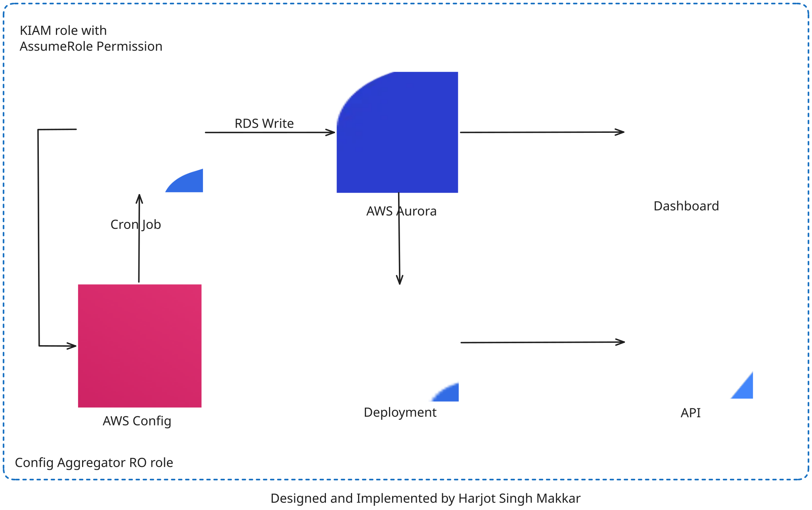
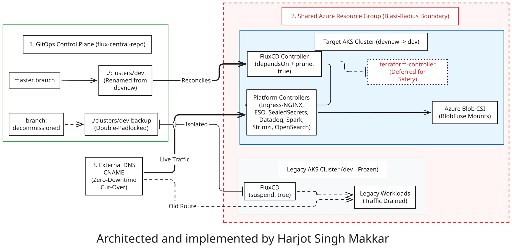
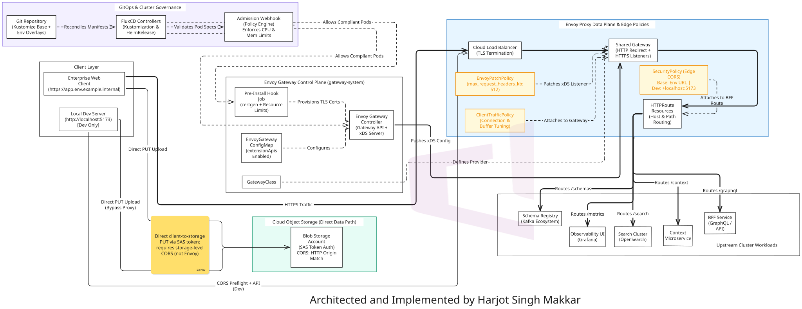

 

  
  
  
  

---

### About & Engineering Philosophy

I work at the intersection of **Cloud Infrastructure**, **Platform Engineering**, and **Site Reliability Engineering**—operating remote, multi-account enterprise cloud environments across **AWS** and **Azure**.

I treat infrastructure strictly as software: **declarative, version-controlled, observable, and recoverable**. Rather than treating a successful deployment command as the finish line, I focus on automated verification, traffic-safe migrations, security gates, and eliminating repetitive operational toil.

- **Current Focus:** Production Kubernetes operations, GitOps delivery, multi-account cloud automation, and resilience engineering.
- **Independent Product:** Architecting [**ATS Certify**](https://atscertify.com) — an ATS-first résumé engineering and validation platform combining deterministic parsing with targeted semantic analysis.
- **Technical Writing:** Publishing deep dives on Kubernetes migrations, restore probes, and cloud automation on [**Substack**](https://harjotsinghmakkar.substack.com).

---

### Production Engineering Highlights

<table>
  <tr>
    <td width="50%" valign="top">
      <h4>Kubernetes & Traffic Engineering</h4>
      <ul>
        <li><strong>Zero-Downtime Cluster Cutovers:</strong> Executed live AKS platform migrations via declarative FluxCD GitOps and Terraform workflows.</li>
        <li><strong>Ingress Modernization:</strong> Migrated live production traffic from legacy Nginx Ingress to <strong>Envoy Gateway</strong> with zero dropped requests.</li>
      </ul>
    </td>
    <td width="50%" valign="top">
      <h4>Cloud Automation & FinOps</h4>
      <ul>
        <li><strong>400+ Account Inventory:</strong> Built Python and Kubernetes CronJob automation using cross-account IAM roles and Vault, cutting recurring reporting effort by up to 90%.</li>
        <li><strong>Event-Streaming Cleanup:</strong> Automated Terraform teardowns of idle Event Hubs capacity across 4 environments (~$70K annualized savings).</li>
      </ul>
    </td>
  </tr>
  <tr>
    <td width="50%" valign="top">
      <h4>Reliability & Storage Pipelines</h4>
      <ul>
        <li><strong>Verified Disaster Recovery:</strong> Engineered automated OpenSearch snapshot and restore-probe verification workflows to prove recovery readiness.</li>
        <li><strong>Batch Pipeline Acceleration:</strong> Refactored sequential file-transfer workflows into validated batch pipelines, cutting benchmark runtime from ~33m to ~72s.</li>
      </ul>
    </td>
    <td width="50%" valign="top">
      <h4>DevSecOps & CI/CD Governance</h4>
      <ul>
        <li><strong>Reusable Security Gates:</strong> Authored GitHub Composite Actions integrating <strong>Wiz</strong>, <strong>Coverity</strong>, and <strong>Black Duck</strong> with automated severity parsing.</li>
        <li><strong>Data-Platform Hardening:</strong> Triaged and remediated 170+ Critical/High vulnerabilities across Schema Registry infrastructure down to zero.</li>
      </ul>
    </td>
  </tr>
</table>

---

### Reference Architecture Showcase

> *Sanitized architectural blueprints stored in `./assets/diagrams/`. Click each panel to inspect.*

  
<strong>01. Multi-Account Cloud Inventory Automation (400+ Accounts)</strong>

   
  

    
  

   

  
<strong>02. Zero-Downtime Kubernetes Cluster Cutover (GitOps + Terraform)</strong>

   
  

    
  

   

  
<strong>03. Zero-Drop Ingress Modernization (Nginx to Envoy Gateway)</strong>

   
  

    
  

   

<!-- UNCOMMENT ONCE backup.svg IS ADDED TO assets/diagrams/

  
<strong>04. OpenSearch Automated Snapshot & Restore-Probe Verification</strong>

   
  

    
  

   

-->

<!-- UNCOMMENT ONCE migration.svg IS ADDED TO assets/diagrams/

  
<strong>05. High-Throughput Storage & Cross-Boundary Migration Pipeline</strong>

   
  

    
  

   

-->

---

### Tech Stack & Tooling

**Cloud & Infrastructure as Code**  

**Containers, Orchestration & Networking**  

**Observability, CI/CD & DevSecOps**  

**Languages, Automation & Data Platforms**  

---

### GitHub Metrics & Activity

  
  

  

 

  

